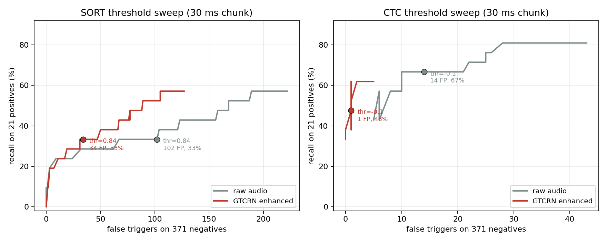
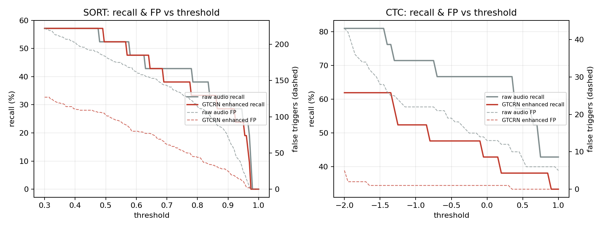
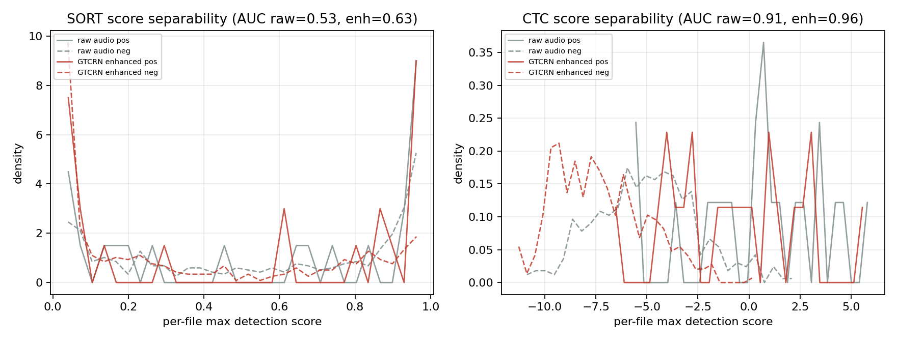
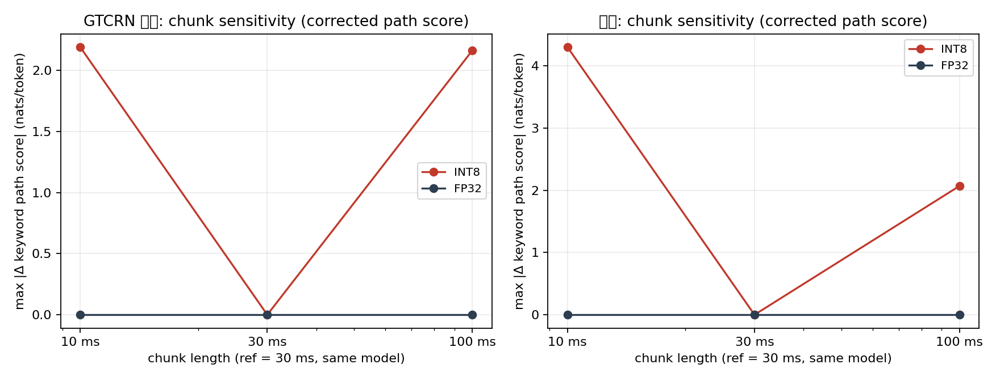
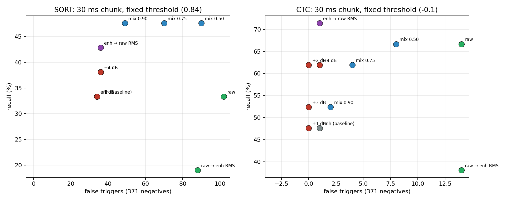
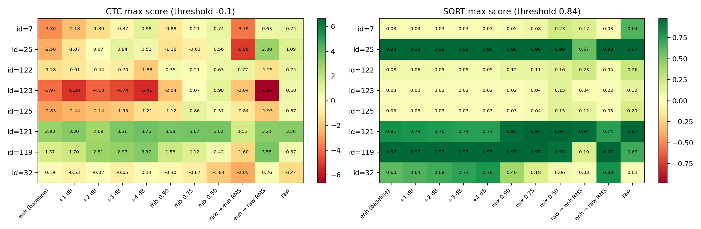

# GTCRN 增强输出优化实验报告（不改 KWS 模型）

日期：2026-11-11 ｜ 数据：392 条配对（21 正 / 371 负）｜ 判决：SORT 0.84、CTC −0.10，30 ms chunk
代码与逐样本结果：`kws_enhancement_opt/`（未覆盖 `kws_enhancement_eval/` 任何既有文件）

---

## 0. 结论速览

**能否只调整 GTCRN 输出、不改 KWS 模型，恢复 CTC 唤醒并保住误触发抑制收益？**

**能恢复大部分，且不必牺牲已获得的误触发抑制。** 最直接、可部署的做法是给 GTCRN 输出加一个**固定 +2 dB 增益**（等价于补偿其系统性电平损失，中位 −1.98 dB）：

| 方案 | SORT Recall | SORT 误触发 | CTC Recall | CTC 误触发 |
|---|---|---|---|---|
| 原始音频 raw | 7/21 (33.3%) | 102 | 14/21 (66.7%) | 14 |
| 现有 GTCRN 增强（基线） | 7/21 (33.3%) | 34 | 10/21 (47.6%) | 1 |
| **GTCRN +2 dB（推荐候选）** | **8/21 (38.1%)** | **36** | **13/21 (61.9%)** | **0** |
| GTCRN 逐条匹配 raw RMS（仅归因） | 9/21 (42.9%) | 36 | 15/21 (71.4%) | 1 |

- **+2 dB 对 5 条新增漏检只恢复 1 条（25）**；同一条候选还额外找回 31、117 —— 这两条在 raw 与 enhanced 下都漏，不属于“新增漏检”。因此 +2 dB 的 CTC 13/21 中，真正“被增强弄丢又找回”的只有 1 条，其余 2 条是额外收益。
- 逐条 RMS 匹配可恢复新增漏检中的 **7、25 两条**，并额外找回 31、40、117；CTC 达到 15/21，**超过 raw 的 14/21** 且误触发仅 1。
- SORT 基本持平略升（+1 TP、+2 FP），原有 34 的误触发抑制收益没有被破坏；SORT 新增漏检 121 只能靠掺入 raw（mix）恢复，本报告的固定增益方案救不回。
- 只调 CTC 阈值（−0.10 → −1.4～−1.65）也能到 13/21 @1 FP，但恢复的样本集合与 +2 dB 不同，且对 SORT 无效；因此**阈值校准只是归因手段，不是最终方案**。
- 剩余漏检的主因不是电平，而是**增强对弱关键词能量的过度抑制**：5 条新增漏检中有 4 条（7、25、123、125）关键词 token 峰值概率从 0.75–0.87 跌到 0.08–0.18，路径分数下降 3.2–4.6 nats/token，远超 ~1 nat 的电平偏移量；122 的下降较温和（0.82→0.32，路径分 −1.28），刚好落在约 1.2 nats 的缺口内，因此**可被阈值下调（≤−1.35）或掺入 raw 恢复，但 +2 dB 仍不够**（+2 dB 后 −0.44）。

---

## 1. 实验设置与可复现性

| 项目 | 配置 |
|---|---|
| 数据 | `kws_dataset/`（raw）与 `gtcrn_enhanced/`（增强）各 392 条，16 kHz 单声道 3.0 s，逐条等长 |
| 配对 | 全部 392 对等长；对齐检查沿用主实验 `data_validation.json`（lag ∈ {−1, 0} 样点，≤0.06 ms） |
| SORT | `kws_cmvn_g1_e100.onnx`（md5 `acc42de…`），阈值 0.84，连续 3 帧 + 500 ms 冷却 |
| CTC | `kws_ctc_v2verifier_e7_int8.onnx`（md5 `743b493…`），阈值 −0.10，触发后 matcher 复位 + 500 ms 冷却；FP32 对照 `kws_ctc_v2verifier_e7.onnx`（md5 `20634b8…`） |
| 分块 | 主实验统一 30 ms（480 samples）；每条音频重建 detector，cache / fbank / matcher / cooldown 全部复位 |
| 环境 | Python 3.9.6，onnxruntime 1.19.2，numpy 1.26.4 |
| 只读约束 | 未修改 ONNX 权重、原始/增强 WAV、`kws_enhancement_eval/` 任何结果 |

**一致性校验（关键）**

1. 本次并行采集的 `enh` 候选重跑结果与主实验 `kws_enhancement_eval/results/*_enhanced.csv` **逐条 triggered 完全一致（0 mismatch，SORT/CTC）**。
2. 阈值离线重放在默认阈值（0.84 / −0.10）上与主实验 CSV **逐条一致（0 mismatch，4 个配置）**，证明重放逻辑与部署判决逐帧等价。

推理规模：sweep 1 568 次、候选消融 8 624 次、chunk 敏感性 4 704 次，共 14 896 次流式推理，均落盘逐样本 CSV 与逐帧分数。

---

## 2. 任务 A：阈值与判决诊断

### 2.1 Recall–误触发曲线





| 配置 | 默认阈值工作点 | 各 FP 预算下的最优 Recall |
|---|---|---|
| SORT raw | 7 TP / 102 FP | FP≤3：4 TP；FP≤34：6 TP；无 FP 限制：7 TP（0.905） |
| SORT enh | 7 TP / 34 FP | FP≤3：4 TP；FP≤34：7 TP（0.860）；FP≤50：8 TP（0.765） |
| CTC raw | 14 TP / 14 FP | FP≤5：9 TP；FP≤10：14 TP（0.35）；FP≤34：**17 TP @28 FP**（−1.5） |
| CTC enh | 10 TP / 1 FP | FP≤0：8 TP（0.35）；FP≤1：**13 TP @1 FP**（−1.65） |

**结论**

- **CTC 可以通过阈值恢复一部分**：−0.10 → −1.4/−1.65 时 10 → 13/21，误触发仍为 1；但再往下 recall 饱和在 13，说明有 4 条样本的分数缺口远大于阈值可移动范围。
- **SORT 不能靠阈值恢复**：在误触发 34 附近 recall 恒为 7/21；即便放宽到 50 FP 也只有 8/21。SORT 的问题是可分性本身弱，而非工作点偏移。
- **要注意**：CTC raw 在 FP≤34 时可达 17/21，说明“增强 + 调阈值”并不是全局最优；增强的收益在于同等误触发下更高召回（13/21 @1 FP vs raw 需 14 FP 才 14/21）。

### 2.2 正负可分性是否改变



| 模型 | AUC(raw) | AUC(enh) | 正样 max 分中位(raw→enh) | 负样 p99(raw→enh) | 正样 p10(raw→enh) |
|---|---|---|---|---|---|
| SORT | 0.525 | **0.626** | 0.687 → 0.603 | 0.975 → 0.973 | 0.026 → 0.026 |
| CTC | 0.909 | **0.960** | 0.743 → **−0.813** | 1.227 → **−1.991** | −3.555 → −3.973 |

- 增强**提升了两者的可分性**（AUC 均上升），但 CTC 整体分数**下移约 1.5 nats/token**（正样中位 0.743 → −0.813），负样 p99 也从 1.227 掉到 −1.991 —— 正负两侧同步平移，与固定阈值 −0.10 不再匹配。
- 这解释了一个看似矛盾的现象：增强让排序更好，却让固定阈值下的召回变差 —— 典型的**判决点未校准**，不是增强无效。CTC 负样 p99 下移幅度（−3.2）大于正样中位下移（−1.6），所以**单纯的全局平移（+2 dB）只能补回一部分**，且会同时抬升负样分数。
- SORT 的分数平移很小（正样中位 −0.08、负样 p99 −0.002），AUC 提升主要来自分布形状变化；它的问题是绝对分数普遍偏低、远离 0.84，不是平移。
- 但 AUC 提升不能解释 4 条分数下降 2.5–4.0 的样本；那部分属于内容失真（见第 4 节）。

### 2.3 CTC chunk 敏感性修正验证（INT8 vs FP32，10/30/100 ms）

**修正说明**：旧 chunk 对比把 `blank` 的 log 概率均值误当作关键词路径分数。本次统一改用 `KeywordPathMatcher` 的真实路径分数（完成路径的 mean per-token log-LR，nats/token），同时保留 blank 均值用于对照。



| 配置 | TP | FP | 误触发次数 | max 路径分中位 |
|---|---|---|---|---|
| FP32 10 ms enh | 10 | 0 | 10 | −7.877 |
| FP32 30 ms enh | 10 | 0 | 10 | −7.877 |
| FP32 100 ms enh | 10 | 0 | 10 | −7.877 |
| INT8 10 ms enh | 9 | 1 | 10 | −7.388 |
| INT8 30 ms enh | 10 | 1 | 11 | −7.376 |
| INT8 100 ms enh | 10 | 1 | 11 | −7.667 |
| FP32 30 ms raw | 15 | 19 | 34 | −4.896 |
| INT8 30 ms raw | 14 | 14 | 28 | −4.844 |
| INT8 100 ms raw | 14 | 15 | 29 | −4.949 |

| 对照（enhanced / raw） | max \|Δ路径分\| | 均值 \|Δ\| | 触发翻转数 |
|---|---|---|---|
| FP32 10/100 ms vs 30 ms | **0.000** | 0.000 | 0 |
| INT8 10 vs 30 ms | 1.255 / 1.603 | 0.302 / 0.344 | 1 / 2 |
| INT8 100 vs 30 ms | 1.626 / 1.882 | 0.359 / 0.396 | 0 / 3 |
| INT8 30 ms vs FP32 30 ms | 2.375 / 3.416 | 0.571 / 0.518 | 3 / 8 |

**结论**

- **FP32 对 chunk 长度完全不敏感**（Δ = 0.000），证明该流式模型逐帧因果、分块方式不影响数学结果；此前“chunk 敏感”的表象来自 **INT8 量化 + blank 分数误用**。
- **INT8 存在真实的 chunk 相关抖动**：仅换 chunk 长度就有 0.30–0.40 nats/token 的均值偏差、最大 1.6–1.9，足以翻转 0–3 条边界样本。
- **INT8 vs FP32 的量化偏差更大**：均值 0.44–0.57、最大 2.1–4.3，raw 条件下触发数 28 vs 34、FP 14 vs 19。对于本数据集里大量“擦线”正样本，这个量级不可忽略。
- 部署口径（30 ms + INT8）自洽，但**跨 chunk 部署会改变召回**；不要用 10 ms 的调参结论直接套到 30 ms 设备上。

---

## 3. 任务 B：增强输出消融（不重训）

全部候选使用同一 SORT 0.84 / CTC −0.10、30 ms、392 条完整测试；音频在内存中生成（不落盘、不重量化），每条记录实际缩放系数、RMS、峰值与削波样点数。

### 3.1 主结果

| 候选 | 说明 | SORT TP/FP | SORT Recall (Δ) | CTC TP/FP | CTC Recall (Δ) |
|---|---|---|---|---|---|
| `enh` | 现有增强（基线） | 7 / 34 | 33.3% (0) | 10 / 1 | 47.6% (0) |
| `enh_gain_p1` | +1 dB | 7 / 34 | 33.3% (0) | 10 / 0 | 47.6% (0) |
| **`enh_gain_p2`** | **+2 dB** | **8 / 36** | **38.1% (+4.8)** | **13 / 0** | **61.9% (+14.3)** |
| `enh_gain_p3` | +3 dB | 8 / 36 | 38.1% (+4.8) | 11 / 0 | 52.4% (+4.8) |
| `enh_gain_p4` | +4 dB | 8 / 36 | 38.1% (+4.8) | 13 / 1 | 61.9% (+14.3) |
| `mix_a090` | 0.90·enh + 0.10·raw | 10 / 49 | 47.6% (+14.3) | 11 / 2 | 52.4% (+4.8) |
| `mix_a075` | 0.75·enh + 0.25·raw | 10 / 70 | 47.6% (+14.3) | 13 / 4 | 61.9% (+14.3) |
| `mix_a050` | 0.50·enh + 0.50·raw | 10 / 90 | 47.6% (+14.3) | 14 / 8 | 66.7% (+19.0) |
| `raw_rms_to_enh` | raw 按增强后 RMS 等比衰减（诊断对照） | 4 / 88 | 19.0% (−14.3) | 8 / 14 | 38.1% (−9.5) |
| `enh_rms_matched` | 增强逐条匹配 raw RMS（归因） | 9 / 36 | 42.9% (+9.5) | 15 / 1 | 71.4% (+23.8) |
| `raw` | 原始音频 | 7 / 102 | 33.3% (0) | 14 / 14 | 66.7% (+19.0) |



### 3.2 配对变化（相对现有 enhanced）

| 候选 | SORT 新恢复 / 新漏检 / 新增误触发 | CTC 新恢复 / 新漏检 / 新增误触发 |
|---|---|---|
| +1 dB | — / — / — | 117 / **32** / — |
| +2 dB | 31 / — / 159, 319 | **25, 31, 117** / — / — |
| +3 dB | 31 / — / 159, 178, 319 | 25, 117 / **32** / — |
| +4 dB | 31 / — / 159, 178, 233, 319 | **7, 25, 117** / — / 97 |
| mix 0.90 | 31, 101, **121** / — / 17 条 | 117, 122 / **32** / 92 |
| mix 0.75 | 31, 101, 121 / — / 37 条 | 7, 122, 123, 125 / **32** / 92, 201, 293 |
| mix 0.50 | 31, 101, 121 / — / 56 条 | 7, 25, 122, 123, 125 / **32** / 7 条 |
| raw→enh RMS | 121 / 25, 117, 119, 120 / 59 条 | 122 / 32, 119, 120 / 13 条 |
| enh→raw RMS | 31, 40 / — / 159, 178 | **7, 25, 31, 40, 117** / — / — |
| `raw`（参照） | 121 / 119 / 71 条 | 7, 25, 122, 123, 125 / **32** / 13 条 |

要点：

- **+1 dB 是“换一个”而不是“多一个”**：恢复 117，却丢掉此前增强恢复的 32；说明 32 和 117 都是边界样本，分数在阈值附近抖动，任何全局电平/阈值微调都会在两者之间交换。这一点对“在 21 条正样本上挑参数”是明确的警告。
- **+2 dB 是唯一“只增不减”的固定增益**：CTC +3 条（其中只有 25 属于新增漏检，31/117 是 raw 下也漏）、0 新增误触发；SORT +1 TP、+2 FP。
- **干湿混合能救回大部分 CTC 漏检（α=0.75 救 4 条，α=0.50 全 5 条），但 SORT 误触发暴涨**（49 → 70 → 90）。原因是 SORT 对原始噪声敏感，掺入 raw 等于把 SORT 已抑制的误触发放回来。所以“混合”只适合做归因，不能作为 SORT/CTC 双模型方案。
- **raw 按增强后 RMS 衰减**后 SORT 掉到 4/21、FP 仍 88，CTC 掉到 8/21、FP 14：说明 raw 的高误触发不是“电平太高”造成的，电平只是次要因素。

### 3.3 音频统计与削波检查

| 候选 | 应用到音频的增益（中位） | 输出/raw RMS 比（中位） | 峰值最大 | 削波文件数 / 样点数 |
|---|---|---|---|---|
| `enh` | 0 dB | 0.796 | 0.468 | 0 |
| +1 dB | +1.00 | 0.893 | 0.525 | 0 |
| +2 dB | +2.00 | 1.002 | 0.589 | 0 |
| +3 dB | +3.00 | 1.124 | 0.661 | 0 |
| +4 dB | +4.00 | 1.262 | 0.742 | 0 |
| mix 0.90/0.75/0.50 | 0 dB（混合） | 0.810 / 0.834 / 0.881 | ≤0.556 | 0 |
| raw | 0 dB | 1.000 | 1.000 | 0 |
| `enh_rms_matched` | +1.99（p5 +0.88，p95 +5.18） | 1.000 | **4.607** | **1 文件 / 124 样点（id=107，+19.9 dB）** |

- 所有固定增益与混合候选**均未削波**（峰值 ≤ 0.742）。
- `enh_rms_matched` 受 id=107（raw RMS 0.136，本身已削波）影响出现 +19.9 dB 增益与 4.6 峰值；这是它不能直接部署的原因之一。所有候选都**没有做静默归一化或限幅**，结果即所报。
- 混合前时间对齐：392 对全部等长，最大 lag 1 样点（0.0625 ms），可忽略。

### 3.4 候选排序（按双模型综合效果）

| 排名 | 候选 | 理由 | 可部署性 |
|---|---|---|---|
| 1 | **`enh_gain_p2`（+2 dB）** | CTC +3 召回（含新增漏检 25）、误触发 1→0；SORT +1 TP、+2 FP；无新增漏检 | 可直接部署（固定增益） |
| 2 | `enh_rms_matched` | CTC 15/21 @1 FP，SORT 9/21 @36 FP，最优指标 | 仅归因：需 raw 参考电平，且有削波风险 |
| 3 | `mix_a090` | SORT 10/21（且找回 121），CTC 11/21 | 双模型折中差：SORT FP +15 |
| 4 | `enh_gain_p4` | CTC 13/21 | 新增 SORT 误触发 4 条、CTC 1 条 |
| 5 | `enh_gain_p3` | 居中 | 劣于 +2/+4，无优势 |

> 排序只针对本 392 条数据。+2 dB 的取值来自**音频电平统计（中位 −1.98 dB）**，不是在最优化 21 条正样本上扫出来的；但仍需独立数据验证。

---

## 4. 任务 C：漏检与恢复样本归因



| id | 类型 | RMS 变化 | SORT max（raw→enh） | CTC 最大路径分（raw→enh） | 关键词 token 峰值概率（raw→enh） |
|---|---|---|---|---|---|
| 7 | CTC 新增漏检 | −4.31 dB | 0.635 → 0.025 | 0.743 → **−3.299** | 0.842 → 0.082 |
| 25 | CTC 新增漏检 | −6.15 dB | 0.967 → 0.977 | 1.092 → **−2.579** | 0.865 → 0.184 |
| 122 | CTC 新增漏检 | −2.79 dB | 0.260 → 0.075 | 0.743 → **−1.278** | 0.816 → 0.322 |
| 123 | CTC 新增漏检 | −4.00 dB | 0.122 → 0.025 | 0.604 → **−3.973** | 0.842 → 0.082 |
| 125 | CTC 新增漏检 | −2.52 dB | 0.204 → 0.026 | 0.372 → **−2.834** | 0.753 → 0.158 |
| 121 | SORT 新增漏检 | −4.96 dB | 0.971 → **0.806** | 3.299 → 2.927（仍触发） | 0.989 → 0.986 |
| 119 | SORT 恢复 | −4.41 dB | 0.687 → **0.966** | 0.371 → 1.371 | 0.717 → 0.931 |
| 32 | CTC 恢复 | −4.44 dB | 0.025 → 0.603 | −1.441 → **0.186** | 0.408 → 0.786 |

**“新增漏检 × 候选”恢复矩阵**（✓ = 触发；— = 未触发；阈值列 = 仅把判决阈值下调到 CTC −1.35 / SORT 无收益）

| 样本 | 模型 | +1 dB | +2 dB | +3 dB | +4 dB | RMS 匹配 | mix .90 | mix .75 | mix .50 | 仅调阈值 | raw |
|---|---|---|---|---|---|---|---|---|---|---|---|
| 7 | CTC | — | — | — | ✓ | ✓ | — | ✓ | ✓ | — | ✓ |
| 25 | CTC | — | ✓ | ✓ | ✓ | ✓ | — | — | ✓ | — | ✓ |
| 122 | CTC | — | — | — | — | — | ✓ | ✓ | ✓ | ✓ | ✓ |
| 123 | CTC | — | — | — | — | — | — | ✓ | ✓ | — | ✓ |
| 125 | CTC | — | — | — | — | — | — | ✓ | ✓ | — | ✓ |
| 121 | SORT | — | — | — | — | — | ✓ | ✓ | ✓ | 不适用 | ✓ |

- 固定增益只能覆盖 7（+4 dB）与 25（+2 dB 起）；122 的缺口 1.2 nats 恰好卡在 +2 dB（−0.44）与 +3 dB（−0.70）之间，只有阈值 −1.35 或掺 raw 能过线；123、125 的缺口达 2.7–3.9 nats，必须靠掺入 raw。
- 121 是另一类：它的 SORT 峰值 0.806 只差阈值 0.034，但**增益把它继续压低**（+4 dB 后 0.741），说明该样本的 SORT 分数不随整体电平单调上升，只能靠引入原始高频证据（mix ≥0.90 → 0.946）恢复。
- 这也解释了为什么 mix 能“全救”：raw 本身对这 5 条全部触发（见最右列），混合只是把被增强抹掉的证据按比例还回来。


单样本图（原始/增强 log-mel、SORT 逐帧概率、CTC 路径分数、六类 token 概率、Fbank 频带能量）：
[case_7](../figures/case_7.png) ｜ [case_25](../figures/case_25.png) ｜ [case_122](../figures/case_122.png) ｜ [case_123](../figures/case_123.png) ｜ [case_125](../figures/case_125.png) ｜ [case_121](../figures/case_121.png) ｜ [case_119](../figures/case_119.png) ｜ [case_32](../figures/case_32.png)

### 4.1 三类原因的证据强度

**已验证（有直接证据）**

1. **全局电平偏移**：增强输出 RMS 中位为 raw 的 0.796 倍（−1.98 dB，p10 −4.03 dB，p90 −1.08 dB）；CTC 正样 max 分中位同步下移约 1.5 nats/token；+2 dB 固定增益把 CTC 正样中位分从 −0.813 抬到 +0.070（+0.88），相当于把判决阈值整体下调 0.88；但因为逐条抬升量不同，触发集合与只调阈值并不重合（13 TP vs 11 TP @阈值 −1.0）。
2. **电平不是逐文件解释**：392 条上“逐条分数变化 vs 逐条 RMS 变化”的 Spearman 相关接近 0（SORT ρ=−0.027, p=0.60；CTC ρ=+0.021, p=0.68）。也就是说**电平是全体性平移，不是“哪条降得多哪条就挂”**。
3. **弱关键词样本被过度抑制**：5 条新增漏检中 4 条（7、25、123、125）关键词 token 峰值概率跌到原值的 10%–21%，路径分数下跌 3.2–4.6 nats/token，远超 ~1 nat 的电平效应；122 下降较温和（0.816→0.322，路径分 −1.28），属于部分失真。
4. **SORT 的 121 不是电平问题**：它的 CTC 路径分几乎不变（3.30→2.93，仍触发），但 SORT 峰值 0.971→0.806 跌到阈值之下；同时其高频带（4–8 kHz）能量 −15.1 dB。增强的高频衰减直接抹掉了 SORT 依赖的线索。
5. **恢复样本确实来自增强收益**：119 与 32 的关键词峰值概率与路径分数都是上升的（0.72→0.93、0.41→0.79），不是阈值抖动。

**假设（尚未直接证实）**

- “+2 dB 在部署中同样有效”属于外推假设：本轮只在 21 条正样本与 371 条负样本上验证，且 +2 dB 会同时抬升 SORT 分数（+2 FP），在更大数据上可能表现为工作点整体平移。
- `mix_a050` 能救回全部 5 条 CTC 漏检，说明原始信号里保留了增强丢掉的关键词能量；但具体是“能量被压低”还是“频谱被改写”尚不能完全分离（需要逐帧对齐的增强前后能量流分析或 GTCRN 中间层诊断）。
- INT8 与 FP32 的触发差异（raw 条件 FP 14 vs 19）说明边界样本的判决对量化误差敏感；本轮未评估这种敏感性对生产环境误唤醒率的影响。

---

## 5. 最终回答与建议

### 5.1 直接回答

**可以在不改 KWS 模型的前提下，仅通过调整 GTCRN 输出恢复 CTC 的主要唤醒能力，并保住误触发抑制收益。**

- 固定 **+2 dB**：CTC 10 → **13/21**，误触发 1 → **0**；SORT 7 → **8/21**，误触发 34 → 36；相对 raw（CTC 14/21 @14 FP、SORT 7/21 @102 FP），两个模型的误触发抑制收益完整保留。其中新增漏检只找回 25，另外 2 条（31、117）原本 raw/enhanced 都漏，属于额外收益。
- 若允许使用参考电平（离线/具备 VAD 增益估计的场景），逐条 RMS 匹配可到 CTC **15/21 @1 FP**、SORT 9/21 @36 FP，是上限参考；对 5 条新增漏检只找回 7、25 两条。
- 纯阈值方案（CTC −0.10 → −1.35）可到 13/21 @1 FP，但恢复的是 122、31、117，与 +2 dB 的重叠只有 31/117；只对 CTC 有效，且无法再往上，因此**不建议只改阈值**。
- **5 条新增漏检没有任何单一“零成本”方案能全部恢复**：固定增益最多 2 条（7、25），阈值最多 1 条（122），只有 α≤0.75 的干湿混合能覆盖 4–5 条，但同时把 SORT 误触发从 34 抬到 70–90。

### 5.2 是否需要修改/微调 GTCRN

建议分三步，按代价从低到高：

1. **先做输出电平补偿**（+2 dB 固定增益，或把输出 RMS 归一到目标区间）。这是零训练成本、可立即验证的一步，本轮已给出量化收益。
2. **再评估高频与弱能量保留**：121（SORT）与 123/125（CTC）表明增强在高频/弱发音上过度抑制。若目标是 SORT 也提升，需要 GTCRN 侧调整（如降低抑制强度、保留更多高频、或在损失中加入 KWS 友好的能量约束），而不是继续在输出端做线性处理。
3. **GTCRN 微调放最后**：本轮证明“电平补偿可拿回大部分 CTC 收益”，微调的边际收益需要用独立数据验证后再决定；且微调必须保持 SORT/CTC 的误触发不反弹。

### 5.3 部署注意

- 增益应与现有前后端链路（麦克风灵敏度、AGC、播放音量）联合标定；+2 dB 是针对本数据集 GTCRN 输出的**电平统计**，换设备/换噪声条件需重新测量。
- 若线上使用 INT8 且 chunk 长度可能变化，需按 30 ms 口径标定阈值；10 ms 下的触发结果不可直接迁移（第 2.3 节）。

---

## 6. 局限

1. **正样本只有 21 条**，所有候选差异（±1–3 条）都在统计噪声量级；本报告未做显著性检验，也不宣称泛化收益。
2. 候选参数（+2 dB、α 取值）来自电平统计与预设网格，未在 21 条上做精细搜索；但 +2/+4 dB、α=0.9/0.75/0.5 的单调趋势仍可能包含选择偏差，需独立数据复核。
3. 未做 GTCRN 重训练或微调；未分析增强前后逐帧能量流，因此“过度抑制”的具体机制仍是假设。
4. `enh_rms_matched` 在 id=107 上峰值 4.6（未限幅），仅作归因；实际部署必须限幅或做异常保护。

---

## 7. 文件与复现

```
kws_enhancement_opt/
├── scripts/
│   ├── common.py              # 路径/候选构造/流式推理封装/判决重放/指标
│   ├── experiments.py         # 三个实验的任务清单
│   ├── run_jobs_cli.py        # 单进程顺序执行（每条复位、30ms）
│   ├── dispatch.py            # 分片调度 + CSV/npz 合并
│   ├── analyze_sweep.py       # 任务 A1
│   ├── analyze_chunk.py       # 任务 A2
│   ├── analyze_candidates.py  # 任务 B
│   ├── analyze_cases.py       # 任务 C
│   ├── fig_sweep.py           # 图 1–3
│   └── fig_candidates.py      # 图 4 + 案例热图
├── results/
│   ├── run_metadata.json
│   ├── sweep/{all.csv, frames.npz, sweep_*.csv, sweep_summary.json}
│   ├── candidates/{all.csv, frames.npz, candidate_summary.csv, summary.json}
│   ├── chunk/{all.csv, frames.npz, summary.json}
│   └── cases/{case_table.csv, summary.json}
├── figures/                   # 全部对比图（见正文）
└── reports/report.md          # 本报告
```

复现（在 `kws_enhancement_opt/` 下，使用 `/tmp/kws_eval_venv` 或等价环境）：

```bash
python scripts/dispatch.py --exp sweep --shards 6 --force
python scripts/analyze_sweep.py
python scripts/dispatch.py --exp candidates --shards 6 --force
python scripts/analyze_candidates.py
python scripts/dispatch.py --exp chunk --shards 6 --force
python scripts/analyze_chunk.py
python scripts/analyze_cases.py
python scripts/fig_sweep.py
python scripts/fig_candidates.py
```

工程说明：macOS 上 `fork` 进程池与 ONNX Runtime 不兼容（单条推理从 0.2 s 退化到 8 s，且 CPU 自旋），因此改用“独立解释器分片 + 每进程单线程 ORT + BLAS 线程数=1”的方案；这保证了多进程并发下吞吐正常（8 624 次推理 156 s）。
