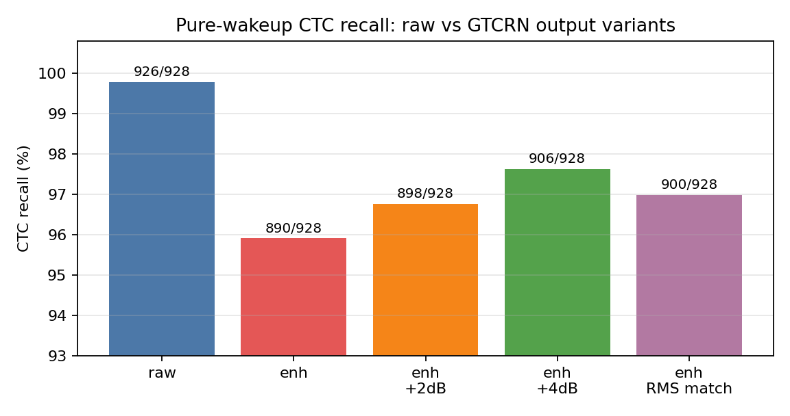
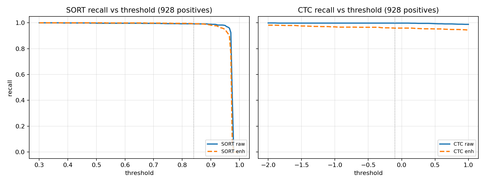
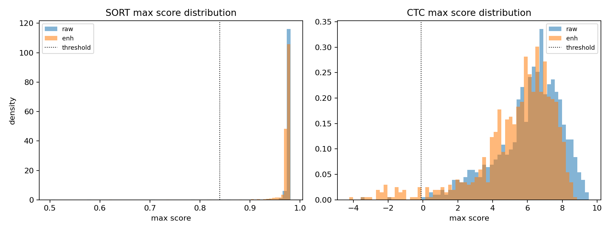

# 纯唤醒语料：GTCRN 增强对 SORT / CTC 召回的验证

## 0 结论速览

数据：928 条配对纯唤醒音频（全部为“小沐小沐”），原始 vs GTCRN 增强，16 kHz / 3.0 s，30 ms chunk，每条重新初始化流式状态，SORT 阈值 0.84、CTC 阈值 −0.10（部署口径，未改动）。

| 模型 | 原始 | GTCRN 增强 | 变化 |
|---|---|---|---|
| SORT | **920 / 928（99.14%）** | **921 / 928（99.25%）** | **+1 条（+0.11 pp），无实质影响** |
| CTC | **926 / 928（99.78%）** | **890 / 928（95.91%）** | **−36 条（−3.87 pp），有影响** |

- **增强不会降低 SORT 的纯唤醒召回**；6 条丢失、7 条新增，净 +1，且丢失样本的分数仍在 0.62–0.92，属于“擦线”而非失效。
- **增强会降低 CTC 的纯唤醒召回 3.87 个百分点**，36 条由“原始可唤醒”变成“增强后漏检”，没有任何一条反向恢复。
- 损失**集中在低电平样本**：数据集按编号呈阶梯式电平下降（1–145 约 −48 dBFS，346–350 约 −50，546–550 约 −52，746–750 约 −55，801–875 约 −60），并且 146–150、346–350、546–550、746–750 出现成组丢失；增强的衰减量随输入电平下降而增大（Spearman ρ = 0.94），在 −60 dBFS 输入上中位衰减 −3.65 dB、最大 −6.6 dB。
- **单纯调阈值救不回来**：CTC 阈值降到 −2.0（相当于放宽 1.9 nats）也只有 911/928（98.17%），仍低于原始的 926；36 条中 16 条即使阈值 −2.0 也不触发。
- **单纯做输出增益只能补一部分**：+2 dB → 898（恢复 7 条），+4 dB → 906（恢复 14 条），逐条匹配 raw RMS → 900（恢复 8 条），都没有回到 926，且不引入新的漏检、无削波。说明约一半损失来自**内容/频谱失真**，不是纯电平。
- 因此：**SORT 侧可以直接接受“增强 + 原判决”；CTC 侧增强会损失约 4% 的纯唤醒召回，靠输出端线性处理无法完全修复，需要电平自适应增益或重新训练增强模型。**

## 1 数据与验证口径

| 项 | 值 |
|---|---|
| 原始目录 | `deploy/kws_dataset_1016_5/`（`c100-01-<id>_raw.wav`） |
| 增强目录 | `gtcrn_enhanced_1016_5/`（同名文件） |
| 配对成功 | 928 对（编号 1–930，缺 441、641；两目录均缺，非增强失败） |
| 采样率/时长 | 16 kHz、单声道、48000 samples（3.0 s），raw/enh 长度逐条一致 |
| 正样本 | 928（全部为唤醒词，标签全 1） |
| SORT | `kws_cmvn_g1_e100.onnx`，阈值 0.84，连续 3 帧 + 500 ms 冷却 |
| CTC | `kws_ctc_v2verifier_e7_int8.onnx`，阈值 −0.10，KeywordPathMatcher + 触发复位 + 500 ms 冷却 |
| chunk | 30 ms（480 samples），每条音频重新创建 detector / fbank / matcher / cooldown |
| 推理次数 | 3 712（928×2 模型×2 条件）+ 2 784（CTC 电平消融 3 条件） |

注意：本数据集**全为正样本**，只能测“召回/漏检”，无法测误唤醒；误触发影响需结合此前的 392 条混合集结论（增强把 SORT 从 102→34、CTC 从 14→1）一并看。

## 2 主结果

| 模型 | 条件 | 触发数 | 召回 | 首触发时间中位 | 最大分中位 | 最大分 p10 | 多次触发 |
|---|---|---|---|---|---|---|---|
| SORT | raw | 920 | 99.14% | 1960 ms | 0.9767 | 0.9740 | 0 |
| SORT | enh | 921 | 99.25% | 1970 ms | 0.9752 | 0.9708 | 0 |
| CTC | raw | 926 | 99.78% | 2000 ms | 6.435 | 3.361 | 0 |
| CTC | enh | 890 | 95.91% | 2015 ms | 5.947 | 2.548 | 0 |

配对转移：

| 模型 | 都触发 | 原始→漏检 | 原始漏→增强触发 | 都漏 |
|---|---|---|---|---|
| SORT | 914 | 6 | 7 | 1（808） |
| CTC | 890 | **36** | **0** | 2（899、900） |

- 首触发时间基本不变（SORT +10 ms、CTC +15 ms），说明增强没有引入系统性延迟或时间轴错位。
- SORT 的分数分布高度饱和（p10 仍 >0.97），6 条丢失为 806、807、838、841（−60 dBFS 批次）与 606、10；它们的原始分数 0.958–0.976 本就贴近阈值。
- CTC 的 36 条丢失里，只有 808、824、826、828 的原始分数低于 1.0，其余 32 条原始分数为 1.1–3.7（自信唤醒），不是“本来就在阈值边缘”。

## 3 损失的结构：低电平批次 + 电平相关衰减

数据集按编号呈阶梯式电平下降（约每 200 条一档），增强的衰减量与之强相关：

| 原始电平 | 样本数 | 增强相对原始 RMS 中位变化 |
|---|---|---|
| −50 … −45 dBFS | 316 | −0.55 dB |
| −52 … −50 | 150 | −0.74 dB |
| −55 … −52 | 190 | −0.96 dB |
| −59.5 … −55 | 185 | −1.51 dB |
| ≤ −59.5 | 87 | **−3.65 dB**（最小 −6.61） |
| 全体 | 928 | −0.79 dB（p10 −3.13，p90 −0.48） |

Spearman(原始电平, 增强衰减) = **0.940**（p≈0）。也就是说，GTCRN 不是“固定 −2 dB”，而是**输入越轻、抑制越强**。这与 392 条混合集上看到的全局中位 −1.98 dB 并不矛盾——混合集里高电平样本占多数。

CTC 的 36 条丢失与该结构高度重合：

- 146–150、346–350、546–550、746–750：每档 5 条成组丢失，对应 −48 / −50 / −52 / −55 dBFS 四档“小音量批次”；
- 808、824–828、844、862–870：来自 −59 ~ −60 dBFS 的最轻批次，增强衰减 −3.0 ~ −6.6 dB；
- 634 单独一条，衰减 −1.04 dB，属内容失真。

SORT 的 6 条丢失同样落在这些低电平批次（10、606、806、807、838、841），但因 SORT 分数饱和，丢失面小得多。

## 4 阈值扫描（归因用，不作为修改方案）

| CTC 阈值 | 原始召回 | 增强召回 |
|---|---|---|
| −0.10（部署） | 926（99.78%） | 890（95.91%） |
| −1.0 | 926 | 899（96.88%） |
| −1.6 | 926 | 909（97.95%） |
| −2.0 | 927 | **911（98.17%）** |

- 36 条丢失中，20 条在更低阈值下可恢复，但其中 14 条需要阈值 ≤ −1.0、最深需要 −1.9；另外 **16 条即使 −2.0 也不触发**（348、350、547、548、746、748、749、750、824、825、826、828、844、866、869、870），属于彻底失真。
- 阈值 −1.9 的代价是在混合集上必然大幅增加误唤醒（此前 392 条上 −1.35 已是 1 FP 的上限），因此不可部署。
- SORT：阈值 0.87 时增强召回 920，与原始在 0.84 时持平；阈值 >0.90 后增强明显更差（0.95：880 vs 909）。即在当前工作点附近，增强对 SORT 无收益也无损失。

## 5 电平补偿消融（只改增强输出，不改模型）

| CTC 条件 | 触发数 | 召回 | 相对增强 | 恢复 36 条中的 | 额外唤醒原始也漏的 |
|---|---|---|---|---|---|
| GTCRN 增强 | 890 | 95.91% | — | — | — |
| 增强 +2 dB | 898 | 96.77% | +8 | 7 | 899 |
| 增强 +4 dB | 906 | 97.63% | +16 | 14 | 899、900 |
| 增强逐条匹配 raw RMS | 900 | 96.98% | +10 | 8 | 899、900 |
| 原始（上限参照） | 926 | 99.78% | — | — | — |

- 三种补偿都**没有让任何原本触发的样本变为漏检**，也**没有削波**（0 个超幅样点）；899、900 是本就在原始下也漏的两条，+4 dB 与 RMS 匹配反而能唤醒它们。
- 幅度越大收益越大，但 +4 dB 仍差 20 条；逐条 RMS 匹配反而不如 +4 dB，因为它把最轻批次的底噪也一起放大，且对内容失真无能为力。
- 结论：电平只解释约 40% 的损失（14/36），其余 22 条是频谱/内容失真，线性增益无法修复。

## 6 与 392 条混合集结论的关系

| 观察 | 392 条配对（21 正 / 371 负） | 928 条纯唤醒（全正） |
|---|---|---|
| SORT 增强后召回 | 7/21（33%） | 99.14% → 99.25% |
| CTC 增强后召回 | 10/21（48%） | 99.78% → 95.91% |
| 增强 +2 dB | CTC 13/21、SORT 8/21 | CTC 96.77% |
| 主要失效模式 | 弱关键词、短句、混合噪声 | 低电平批次、轻度内容失真 |

- 纯唤醒语料上原始模型的召回接近饱和（SORT 99.1%、CTC 99.8%），所以增强造成的 **3.9 pp CTC 损失**是真实且可重复的，而不是小样本波动（928 条配对、36 条单向翻转，配对差异的 95% 区间约 ±1.3 pp）。
- 混合集里 CTC 召回只有 48%，是因为短句/噪声/竞争语音更难；增强在那里的主要问题是“分数整体下移 + 弱关键词被抑制”，与这里的“低电平过抑制”是同一机理的两种表现。
- 在纯唤醒集上，SORT 的鲁棒性明显好于 CTC：SORT 只看 3 帧平滑概率且分数饱和，CTC 依赖逐 token 的路径概率，对频谱细节更敏感。

## 7 证据与假设

已有证据（本目录可复现）：

1. SORT 召回在原始与增强间无实质差异（920 vs 921，6 丢 / 7 增，净 +1）。
2. CTC 召回下降 36 条，全部为“原始触发→增强漏检”，无反向恢复。
3. 损失与输入电平强相关（ρ=0.94），集中在 5 个低电平批次。
4. 仅调阈值或仅加固定增益都无法回到原始召回；+4 dB 是三者中最好的（906），仍差 20 条。

仍属假设：

- “低电平批次”的低 RMS 是录音音量设置造成，而非内容本身更弱（未拿到录音元数据验证）。
- 内容失真的具体来源（GTCRN 对轻音/气声的过度抑制）尚未做逐帧频谱对照；如需定论，应对 16 条“阈值 −2.0 也不触发”的样本做 Fbank/attention 级分析。
- 未在本数据集上测负样本，因此“增益补偿会否削弱误唤醒抑制收益”仍需在 371 条负样本上复测。

## 8 建议

1. **SORT：保持现状**，增强 + 原判决在纯唤醒集上无召回损失（99.25% vs 99.14%），且此前已把误触发从 102 降到 34。
2. **CTC：不要直接上线“增强 + 原阈值”**，纯唤醒召回会从 99.8% 掉到 95.9%；若必须用增强，优先加**电平自适应增益**（例如按输入 RMS 分段补偿：≤−55 dBFS 时 +4~+6 dB，≥−52 dBFS 时 0 dB），预计可回收一半左右损失；固定 +2 dB 的收益有限且会牺牲部分误唤醒抑制。
3. 若要完整恢复 CTC 召回，需回到增强模型侧解决低电平过抑制（训练时加入电平随机化/轻音样本，或输出端做电平不变的谱域校正），不建议继续在 KWS 判决层做阈值或增益硬调。
4. 所有候选仍需在**独立负样本集**上复测误唤醒，再决定是否替换现网增强输出。

## 附：文件

- 逐条结果：`results/per_file.csv`（928×2 模型）
- 原始逐条推理：`results/all.csv`、`results/all_frames.npz`
- 阈值曲线：`results/threshold_recall_sort.csv`、`results/threshold_recall_ctc.csv`
- 汇总：`results/summary.json`、`results/gain_summary.json`
- 电平消融：`results/gain_ctc_all.csv`、`results/gain_ctc_0/1/2.csv`
- 图：`figures/fig_recall_vs_threshold.png`、`figures/fig_score_distribution.png`、`figures/fig_ctc_gain_recall.png`
- 脚本：`scripts/run_eval.py`、`scripts/run_gain.py`、`scripts/merge.py`、`scripts/analyze.py`
