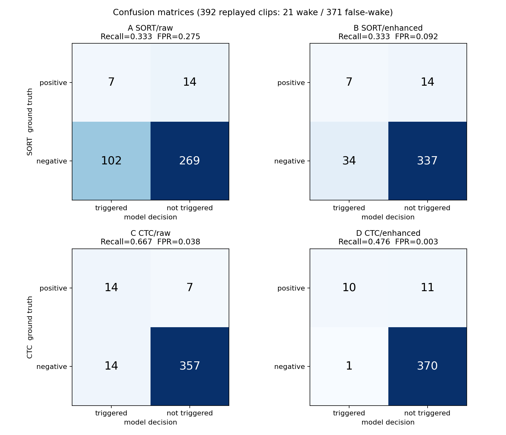
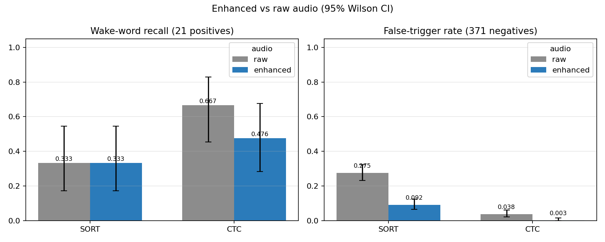
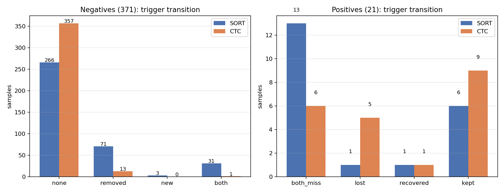
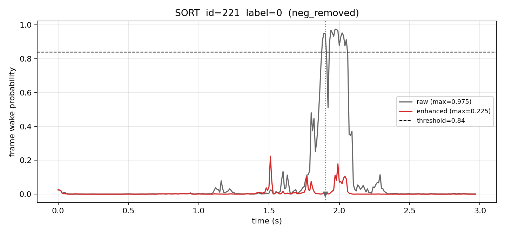
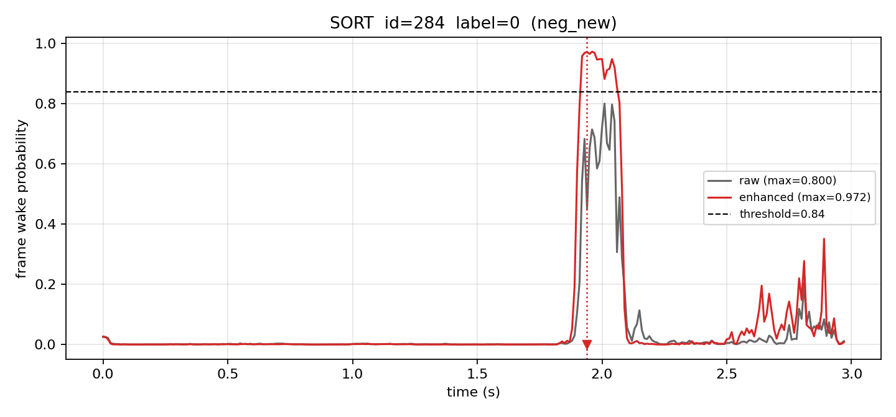
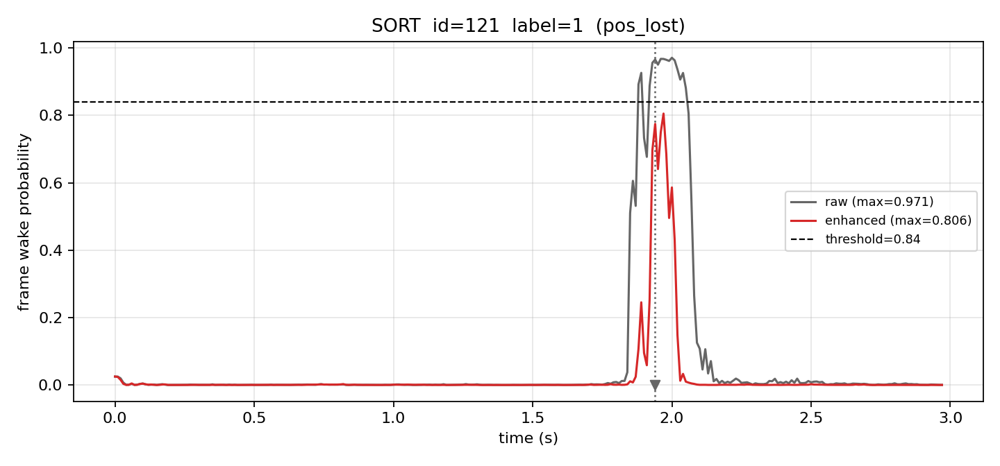
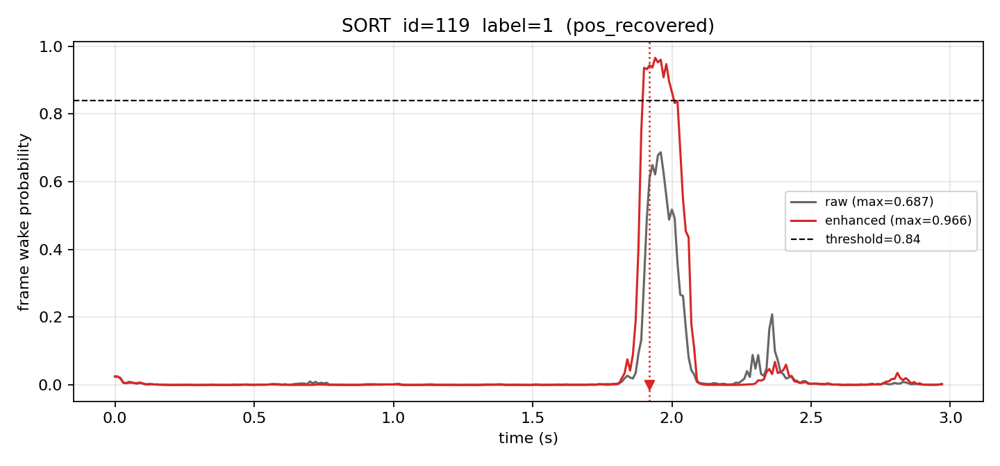
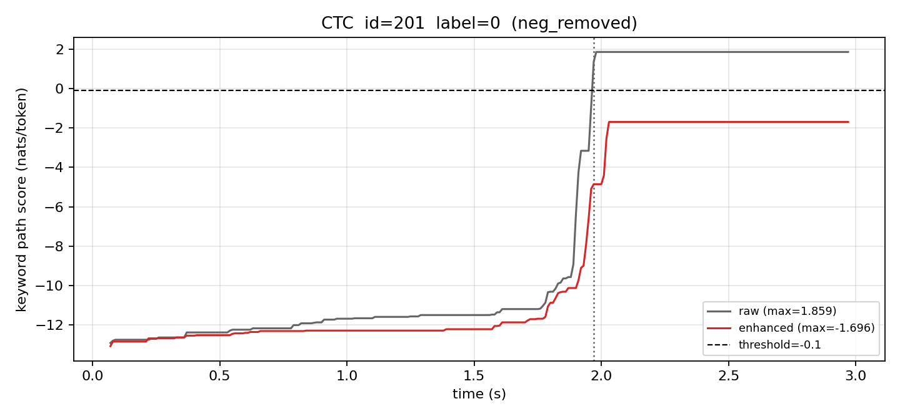
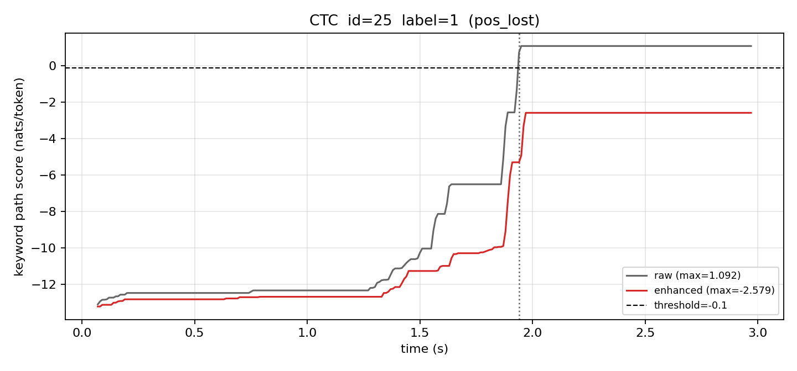
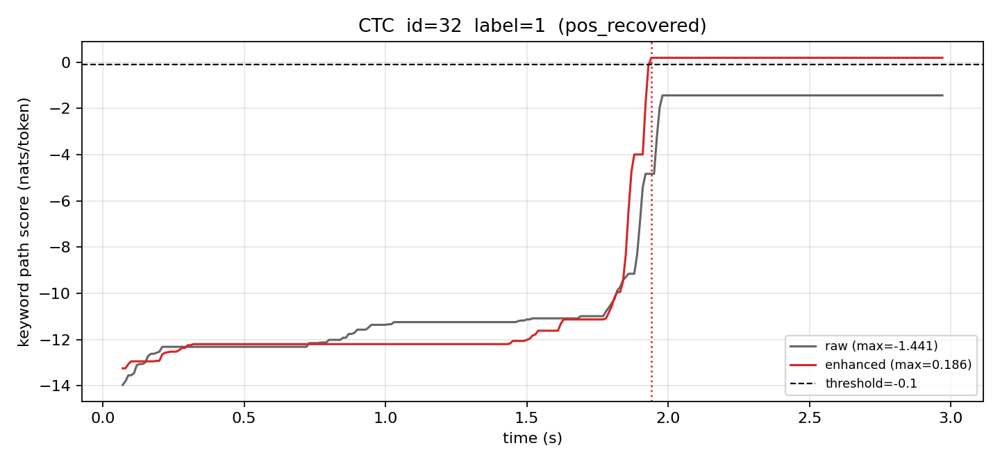

# KWS 双模型语音增强前后效果验证报告

- 数据集：`kws_dataset`（392 条白名单挂测回采音频）与 `gtcrn_enhanced`（同 ID 增强音频）
- 模型：SORT `kws_cmvn_g1_e100.onnx`（thr=0.84）、CTC `kws_ctc_v2verifier_e7_int8.onnx`（thr=-0.10）
- 实验日期：2026-11-10　|　推理记录：4 × 392 = 1568 条，失败 0 条

## 结论摘要

1. **SORT 误唤醒显著下降**：回采负样本触发比例 27.49% → 9.16%（-18.33 pp，相对 -66.67%，抑制 66.67%，McNemar p≈7.2e-18）。
2. **CTC 误唤醒几乎清零**：3.77% → 0.27%（-3.50 pp，相对 -92.86%，抑制 92.86%，McNemar p≈2.4e-04）。
3. **SORT 无净漏检但有边界抖动**：Recall 保持 7/21，其中 1 条漏检（121）、1 条恢复（119）。
4. **CTC 出现明显漏检**：Recall 14/21 → 10/21（-19.05 pp，相对 -28.57%），漏检 7, 25, 122, 123, 125，恢复 32；正样本仅 21 条，配对 McNemar p=0.219，方向明确但统计功效有限。
5. **两模型响应不同**：增强对两者负样本都有效，但 CTC 的正样本分数中位被压低 -1.28 nats/token，在当前工作点上属于“过度抑制”；SORT 正样本分数中位仅变化 -0.015。

## 1. 实验目的、模型配置与数据集标签

### 1.1 目的

在**不训练、不改权重、不改增强算法**的前提下，量化同一套 GTCRN 增强算法对两种已部署 KWS 架构的实际影响，回答：增强是否降低误唤醒、是否造成真实唤醒漏检、两种架构响应是否有差异、哪些样本被改善或退化。

### 1.2 模型与推理配置

| 项目 | SORT | CTC |
|---|---|---|
| 权重 | `kws_cmvn_g1_e100.onnx` | `kws_ctc_v2verifier_e7_int8.onnx` |
| 推理类 | `OnnxKWS`（`deploy_sort/mic_kws.py`） | `CtcKwsSession`（`deploy_ctc/mic_ctc.py`） |
| 阈值 | 0.84 | -0.10 |
| 判决规则 | 最近 3 帧均 ≥ 阈值触发；冷却 500 ms | 关键词路径分数 ≥ 阈值触发；触发后 matcher 复位；冷却 500 ms |
| 分数含义 | 每帧唤醒概率 | 关键词路径平均每 token log-LR（nats/token） |

两组模型均按 30 ms（480 samples）chunk 流式喂入，复用部署包原 `StreamingFbank`，每条音频开始前重建检测器（cache 从 `_init_cache.npy` 重新载入，fbank/matcher/cooldown 全部新建），ONNX session 按模型共享但**不跨样本复用任何声学状态**。原始/增强使用完全一致的参数。旧挂测 JSON 中的 `threshold=0.3` 属设备历史采集配置，未采用。

### 1.3 数据集与标签

| 项 | 值 |
|---|---|
| 总样本 | 392 |
| 真实唤醒（label=1） | 21 条：0, 1, 7, 25, 31, 32, 35, 40, 101, 106, 117, 118, 119, 120, 121, 122, 123, 124, 125, 126, 128 |
| 回采负样本（label=0） | 371 条 |
| 0–395 缺失编号 | 98, 99, 100, 222（原始集本就缺失，不作补齐） |
| 标签来源 | 人工确认真实标签（未使用 JSON 历史触发分数） |

配对方式为文件名 ID 精确匹配（`c100-01-<ID>.wav`），未使用排序位置。`labels.csv` 含 `sample_id,label,raw_path,enhanced_path`。

### 1.4 数据预检查结论

| 检查项 | 结果 |
|---|---|
| 原始 / 增强 WAV 数 | 392 / 392，一一对应 |
| 未配对样本 | 原始独有 无；增强独有 无 |
| 采样率 / 通道 / 时长 | 16000 Hz / 1 声道 / 3.0 s（增强侧 3.0 s） |
| 长度差 | 全部为 0 samples（无裁切/补零） |
| 增强引入时延 | 互相关估计 -1 / 0 samples（-0.06 / 0.0 ms） |
| 异常样本 | 1 条：id=107 原始音频有 366 samples 削波（增强后峰值 0.47，无削波） |

预检查未发现缺失、空音频、NaN/Inf 或长度变化，因此四组统计分母统一为 392（21 正 / 371 负）。增强音频未再做归一化或增益调整；无重采样发生。

### 1.5 推理一致性验证

- T1 标签校验：392 条、21 正样本、缺失编号与预期一致。
- T2 状态复位：同一样本连续 / 交错重复推理，逐帧分数与触发事件逐位一致。
- T3 流式等价：SORT 在 10/30/100 ms chunk 下输出一致；CTC **float** 模型同样一致；CTC **INT8** 模型输出随 chunk 长度变化（同一句 30 ms 与 10 ms 的路径分数最大差 1.99 nats/token），属 INT8 动态量化激活尺度的分块敏感性。部署端与主实验均固定 30 ms，四组条件完全一致，不影响对照公平性。
- T4 官方一致性：CTC 在 id=0/2/101 上与 `mic_ctc.py --wav` 的帧数、触发次数、触发分数完全一致（298 帧；id=0 两侧均为 `score=-0.070` 且触发，id=2 均不触发，id=101 均为 `+1.440`）。
- T5 小样本四组核查：2 正 + 2 负 × 2 模型 × 2 条件全部成功，状态与结果可复现。

## 2. 四组实验结果

| 组别 | TP | FN | FP | TN | Recall (95% CI) | FPR (95% CI) | 触发事件总数 | 平均单条耗时 |
|---|---|---|---|---|---|---|---|---|
| A SORT / 原始 | 7 | 14 | 102 | 269 | 33.33% (17.19%–54.63%) | 27.49% (23.20%–32.25%) | 114 | 165 ms |
| B SORT / 增强 | 7 | 14 | 34 | 337 | 33.33% (17.19%–54.63%) | 9.16% (6.63%–12.53%) | 42 | 141 ms |
| C CTC / 原始 | 14 | 7 | 14 | 357 | 66.67% (45.37%–82.81%) | 3.77% (2.26%–6.23%) | 28 | 241 ms |
| D CTC / 增强 | 10 | 11 | 1 | 370 | 47.62% (28.34%–67.63%) | 0.27% (0.05%–1.51%) | 11 | 235 ms |



Recall=TP/21；FPR=FP/371，仅表示**当前回采负样本**上的触发比例，不能解释为真实部署的每小时误唤醒率（FA/h）。21 条正样本的 Recall 也只代表该选定集合。

## 3. 增强前后差异（同 ID 配对）

| 模型 | Recall raw→enh | 绝对变化 | 相对变化 | FPR raw→enh | 绝对变化 | 相对变化 | 负样本抑制 | McNemar p (负样本) | McNemar p (正样本) |
|---|---|---|---|---|---|---|---|---|---|
| SORT | 33.33% → 33.33% | +0.00 pp | 0.00% | 27.49% → 9.16% | -18.33 pp | -66.67% | 66.67% | 7.16e-18 | 1.000 |
| CTC | 66.67% → 47.62% | -19.05 pp | -28.57% | 3.77% → 0.27% | -3.50 pp | -92.86% | 92.86% | 2.44e-04 | 0.219 |

配对变化计数：

| 情况 | SORT | CTC |
|---|---|---|
| 负样本 raw=1→enh=0（成功消除） | 71 | 13 |
| 负样本 raw=0→enh=1（新引入） | 3 | 0 |
| 负样本 raw=1→enh=1（仍存在） | 31 | 1 |
| 负样本 raw=0→enh=0（均未触发） | 266 | 357 |
| 正样本 raw=1→enh=1（保持唤醒） | 6 | 9 |
| 正样本 raw=1→enh=0（增强漏检） | 1 | 5 |
| 正样本 raw=0→enh=1（增强恢复） | 1 | 1 |
| 正样本 raw=0→enh=0（均漏检） | 13 | 6 |





正样本只有 21 条，比例指标的置信区间很宽（见第 2 节 Wilson CI），正样本上的差异应视为方向性证据；负样本 371 条且为配对比较，用精确 McNemar 检验（SORT p≈7.2e-18，CTC p≈2.4e-4）。

## 4. 具体被改善 / 退化 / 漏检的样本

### SORT

- 成功消除的误触发（71 条）：10, 23, 27, 33, 34, 41, 50, 53, 55, 58, 69, 70, 72, 75, 77, 78, 79, 103, 105, 115, 127, 134, 135, 149, 155, 158, 159, 167, 178, 180, 192, 202, 207, 213, 221, 227, 229, 233, 243, 246, 251, 254, 264, 265, 272, 274, 283, 285, 292, 296, 298, 306, 309, 314, 319, 323, 324, 337, 338, 339, 344, 345, 347, 348, 357, 358, 366, 372, 377, 386, 387
- 新引入的误触发（3 条）：241, 262, 284
- 增强后仍误触发（31 条）：60, 64, 91, 137, 148, 150, 153, 160, 161, 176, 208, 239, 257, 259, 277, 291, 293, 297, 301, 304, 310, 317, 320, 321, 330, 340, 341, 342, 349, 353, 368
- 增强导致真实唤醒漏检（1 条）：121
- 增强恢复真实唤醒（1 条）：119
- 原始/增强均漏检的真实唤醒（13 条）：0, 7, 31, 32, 35, 40, 101, 118, 122, 123, 124, 125, 126

### CTC

- 成功消除的误触发（13 条）：90, 92, 96, 97, 134, 148, 201, 240, 293, 330, 369, 377, 394
- 新引入的误触发（0 条）：无
- 增强后仍误触发（1 条）：383
- 增强导致真实唤醒漏检（5 条）：7, 25, 122, 123, 125
- 增强恢复真实唤醒（1 条）：32
- 原始/增强均漏检的真实唤醒（6 条）：31, 35, 40, 117, 118, 126

所有这些 ID 的原始与增强音频路径可从 `labels.csv` 按 `sample_id` 直接取得，逐条结果见 `results/paired_comparison.csv`。

## 5. 两种模型对增强算法响应的差异

### 5.1 分数分布的整体位移

| 模型 | 正样本 max score 中位变化 | 正样本分数下降>0.1 | 负样本 max score 中位变化 | 负样本分数上升条数 |
|---|---|---|---|---|
| SORT | -0.015 | 6/21 | -0.128 | 78/371 |
| CTC | -1.278 | 16/21 | -2.068 | 24/371 |

（SORT 单位为帧概率，CTC 为 nats/token；两类分数不可直接比较绝对值，这里只比较各自增强前后的位移方向与幅度。）

**SORT**：增强让负样本分数整体下移（中位 -0.128），误触发从 102 降到 34，改善是全局性的（71 条消除 vs 3 条新增）；正样本分数中位几乎不变（-0.015），但 6/21 条下降超过 0.1，出现 1 条漏检（id=121）与 1 条恢复（id=119），净 Recall 不变，说明工作点附近的边界样本仍在抖动。

**CTC**：增强同样压低负样本分数（中位 -2.07），误触发 14→1（仅 id=383 仍触发，未新增误触发）；但正样本分数也大幅下降（中位 -1.28，16/21 条下降>0.1），5 条原本刚过阈值的唤醒被压到阈值以下（7、25、122、123、125），Recall 14/21→10/21（-19.05 pp）。CTC 的判决依赖 8-token 关键词路径相对 blank/fill 的似然优势，增强在抑制噪声的同时也削弱了部分音节（尤其第二遍“小沐”）的 token 判别度，使正负样本一起向低分移动，阈值 -0.10 的余量被吃掉。

### 5.2 同一样本上的正样本对照

| ID | SORT raw/enh | SORT max raw→enh | CTC raw/enh | CTC max raw→enh |
|---|---|---|---|---|
| 0 | 0/0 | 0.06→0.14 | 1/1 | 2.49→-0.09 |
| 1 | 1/1 | 0.98→0.98 | 1/1 | 5.99→5.76 |
| 7 | 0/0 | 0.64→0.03 | 1/0 | 0.74→-3.30 |
| 25 | 1/1 | 0.97→0.98 | 1/0 | 1.09→-2.58 |
| 31 | 0/0 | 0.73→0.86 | 0/0 | -1.30→-1.35 |
| 32 | 0/0 | 0.03→0.60 | 0/1 | -1.44→0.19 |
| 35 | 0/0 | 0.03→0.05 | 0/0 | -5.39→-6.74 |
| 40 | 0/0 | 0.03→0.60 | 0/0 | -3.55→-4.37 |
| 101 | 0/0 | 0.92→0.86 | 1/1 | 1.67→0.88 |
| 106 | 1/1 | 0.98→0.96 | 1/1 | 4.04→2.76 |
| 117 | 1/1 | 0.98→0.98 | 0/0 | -0.74→-0.81 |
| 118 | 0/0 | 0.83→0.30 | 0/0 | -5.74→-3.88 |
| 119 | 0/1 | 0.69→0.97 | 1/1 | 0.37→1.37 |
| 120 | 1/1 | 0.93→0.95 | 1/1 | 2.14→1.14 |
| 121 | 1/0 | 0.97→0.81 | 1/1 | 3.30→2.93 |
| 122 | 0/0 | 0.26→0.08 | 1/0 | 0.74→-1.28 |
| 123 | 0/0 | 0.12→0.03 | 1/0 | 0.60→-3.97 |
| 124 | 0/0 | 0.17→0.07 | 1/1 | 3.41→2.04 |
| 125 | 0/0 | 0.20→0.03 | 1/0 | 0.37→-2.83 |
| 126 | 0/0 | 0.45→0.04 | 0/0 | -2.07→-3.67 |
| 128 | 1/1 | 0.98→0.89 | 1/1 | 4.53→2.97 |

两种模型表现相反的样本：

- 负样本：无“SORT 改善但 CTC 退化”或“CTC 改善但 SORT 退化”的样本；两边同时消除误触发：134, 377。
- 正样本：SORT 漏检而 CTC 保持：121；CTC 漏检而 SORT 保持：7, 25, 122, 123, 125；两者同时漏检：无。

即：**增强对 SORT 的负样本收益大、正样本代价小；对 CTC 的负样本收益同样大，但正样本代价显著**。CTC 原工作点本就偏向低误唤醒（FPR 3.77%），增强后 FPR 仅剩 0.27%，但这是以 5 条真实唤醒为代价换来的，在该工作点上属于“过度抑制”。

### 5.3 典型案例（逐帧分数曲线）

- **SORT 成功消除误触发**：id=221，`kws_dataset/c100-01-221.wav` / `gtcrn_enhanced/c100-01-221.wav`，raw 峰值 0.975 连续过阈，增强后峰值仅 0.225，完全脱离工作点。
  
- **SORT 新增误触发**：id=284，`kws_dataset/c100-01-284.wav` / `gtcrn_enhanced/c100-01-284.wav`，增强后峰值由 0.800 抬到 0.972，跨过 0.84 并满足 3 帧连续。
  
- **SORT 真实唤醒漏检**：id=121，`kws_dataset/c100-01-121.wav` / `gtcrn_enhanced/c100-01-121.wav`，raw 峰值 0.971 触发；增强后峰值 0.806，低于 0.84。
  
- **SORT 增强恢复唤醒**：id=119，`kws_dataset/c100-01-119.wav` / `gtcrn_enhanced/c100-01-119.wav`，raw 峰值 0.687 未触发，增强后 0.966 触发。
  
- **CTC 成功消除误触发**：id=201，`kws_dataset/c100-01-201.wav` / `gtcrn_enhanced/c100-01-201.wav`，路径分数 1.86 → -1.70，远离阈值 -0.10。
  
- **CTC 新增误触发**：本次数据中不存在该类样本（CTC 未新增误触发）。
- **CTC 真实唤醒漏检**：id=25，`kws_dataset/c100-01-25.wav` / `gtcrn_enhanced/c100-01-25.wav`，路径分数 1.09 → -2.58，第二遍“小沐”的 token 优势被削弱。
  
- **CTC 增强恢复唤醒**：id=32，`kws_dataset/c100-01-32.wav` / `gtcrn_enhanced/c100-01-32.wav`，-1.44 → 0.19，刚刚越过阈值。
  

曲线中竖点线为该条件下的首次触发时刻，水平虚线为判决阈值；CTC 曲线为独立 matcher 重放的逐帧路径分数（不随触发复位），触发判定仍以流式事件为准。

## 6. 未解决问题、失败情况与适用范围

1. **无推理失败**：1568 条记录全部 `status=ok`，四组各 392 条；原始/增强按 ID 全配对。
2. **样本量与口径**：FPR 是 371 条回采负样本上的触发比例，不是 FA/h；Recall 只代表 21 条选定正样本。正样本差异的统计功效有限（CTC 的 5 条漏检 McNemar p=0.219，方向明确但未达 0.05 显著）。
3. **CTC INT8 分块敏感性**：同一句在 10/30/100 ms chunk 下路径分数最大差约 2–2.8 nats/token，足以跨越 -0.10 阈值。本报告结论仅对应部署口径（30 ms chunk）。若部署端 chunk 长度改变，CTC 的绝对结果需要重新测量；float 模型无此问题（chunk 间最大差 0）。
4. **增强未做增益归一化**：增强后整体电平略降（中位 RMS 0.00286→0.00217），可能同时贡献了分数下移；本次按要求不做静默归一化，因此“抑制过强”是增强链路的整体表现，未拆分去噪与电平两个因素。
5. **单一增强算法/单一工作点**：只评估了当前 GTCRN 增强与部署默认阈值（SORT 0.84、CTC -0.10），未做阈值扫描。若要为 CTC 挽回 Recall，应在同一增强条件下重新选择工作点（例如降低阈值），但必须与原始条件同口径比较，不能“增强+调阈值”对“原始默认阈值”。
6. **特殊样本**：id=107 原始音频存在 366 samples 削波，增强后无削波；该样本的两模型结果均正常，但它是原始侧唯一的质量异常，若后续扩大评估需关注采集链路。
7. **未评估**：未使用 `deploy/kws_dataset_1016_5`（928 条纯唤醒语料）；未评估连续自然运行中的 FA/h；未评估两模型的 float/int8 差异对结论的影响（主实验即部署 INT8 权重）。

**结论适用性**：本报告可直接用于判断当前 GTCRN 增强对已部署 SORT/CTC 的收益与副作用，但不能外推为其他增强算法、其他阈值或其他 chunk 配置下的结论。

## 7. 产物与复现

```text
kws_enhancement_eval/
├── config.yaml                 # 主实验固定参数
├── labels.csv                  # 392 条 sample_id / label / raw_path / enhanced_path
├── data_validation.json        # 配对、格式、长度、时延、异常检查
├── results/
│   ├── sort_raw.csv  sort_enhanced.csv  ctc_raw.csv  ctc_enhanced.csv   # 各 392 行
│   ├── paired_comparison.csv   # 784 行 = 2 模型 × 392 样本
│   ├── summary.json            # 全部指标、配对计数、ID 列表
│   └── frame_scores/*.npz      # 逐帧分数曲线
├── figures/                    # 混淆矩阵、Recall/FPR、配对转移、典型案例
├── reports/evaluation_report.md
├── logs/
└── scripts/                    # prepare_dataset / evaluate_kws / analyze_results / test_kws_eval
```

```bash
python scripts/prepare_dataset.py --raw-dir ../kws_dataset \
    --enhanced-dir ../gtcrn_enhanced --output-dir ..
python scripts/evaluate_kws.py --raw-dir ../kws_dataset \
    --enhanced-dir ../gtcrn_enhanced --deploy-dir ../deploy --output-dir ..
python scripts/test_kws_eval.py --raw-dir ../kws_dataset \
    --enhanced-dir ../gtcrn_enhanced --deploy-dir ../deploy --output-dir ..
python scripts/analyze_results.py --output-dir ..
```

`evaluate_kws.py` 支持断点续跑：已存在且 `status=ok` 的 sample_id 自动跳过；单样本错误会写入 `status=error` 与 `error` 列，不会静默计为未触发。

